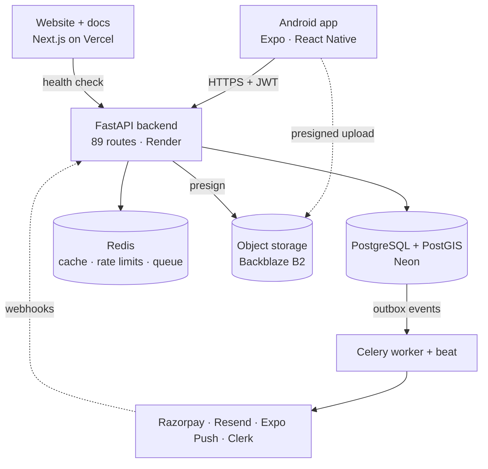
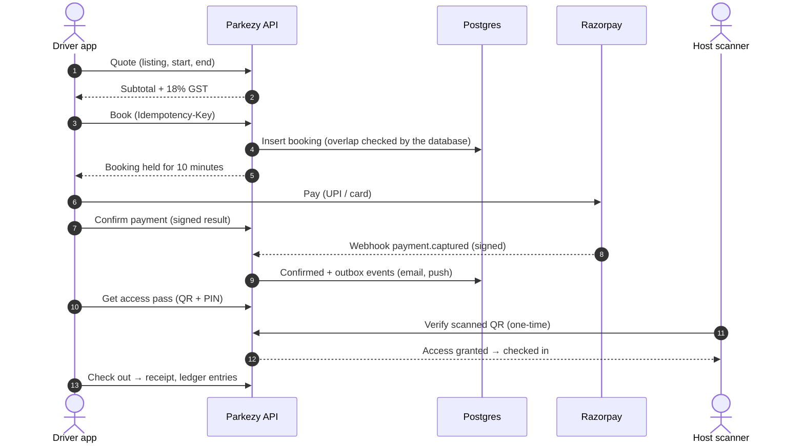
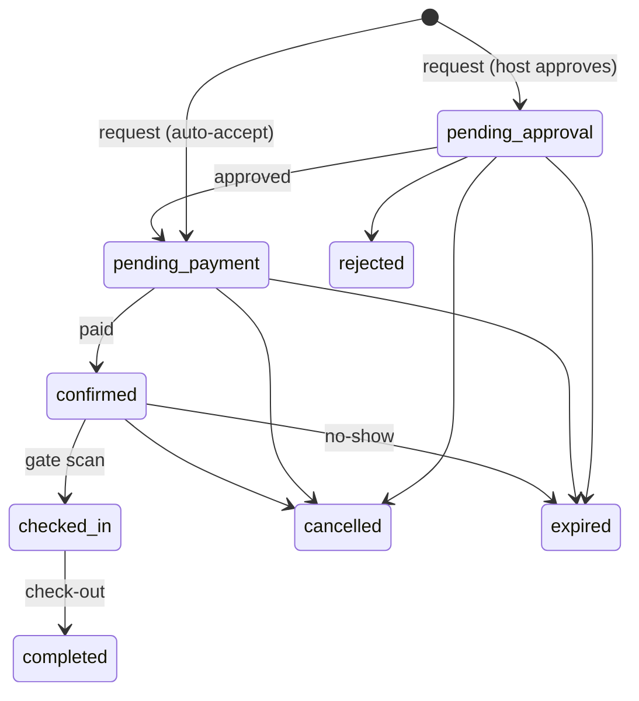

<div align="center">

# Parkezy

**Find, book and unlock a parking spot in seconds, or earn from the one you don't use.**

[](https://github.com/honoursbhaduria/Parkezy-2.0/releases/latest)
[](https://parkezy-landing.vercel.app)
[](https://parkezy-landing.vercel.app/docs)
[](https://parkezy-api.onrender.com/health/ready)
[](https://expo.dev)
[](https://postgis.net)

[**Download the Android app**](https://github.com/honoursbhaduria/Parkezy-2.0/releases/latest/download/parkezy.apk) ·
[Website](https://parkezy-landing.vercel.app) ·
[How it works](https://parkezy-landing.vercel.app/docs) ·
[Releases](https://github.com/honoursbhaduria/Parkezy-2.0/releases)

</div>

---

Parkezy is a two-sided parking marketplace. **Drivers** search a map for nearby spots, see the full price up front, book in a few taps and open the gate with a QR code or a 6-digit PIN. **Hosts** list a driveway, garage or basement bay, approve or auto-accept requests, scan drivers in at the gate and withdraw their earnings.

It is a complete, deployed product: an Android app, a FastAPI backend with background workers, a PostgreSQL/PostGIS database, and a website with in-depth [system design documentation](https://parkezy-landing.vercel.app/docs).

## Contents

- [Features](#features)
- [How it works](#how-it-works)
- [Engineering highlights](#engineering-highlights)
- [Tech stack](#tech-stack)
- [Repository layout](#repository-layout)
- [Run it locally](#run-it-locally)
- [Testing and quality](#testing-and-quality)
- [Deployment](#deployment)
- [Releases](#releases)
- [Security](#security)
- [Documentation](#documentation)
- [Team](#team)

## Features

### For drivers

| | |
|---|---|
| **Map search** | Spots near you or any locality, within up to 25 km, with distance, price, rating and free slots for your time window |
| **Filters** | EV charging, covered, CCTV, security guard, gated, well lit, wheelchair access, slot type (standard, compact, large, EV, accessible, bike) |
| **Transparent pricing** | The server quotes the exact price before you book: per-minute rate, optional daily cap, 18% GST |
| **Booking** | Instant for auto-accept spots, or a request the host approves; retries never create a duplicate booking |
| **Payments** | Razorpay checkout (UPI, cards), verified on the server; refunds handled automatically on cancellation |
| **Access pass** | A QR code that refreshes itself every two minutes, plus an offline 6-digit PIN for basements with no signal |
| **Live session** | Check-in and check-out, extend a booking, a reminder 15 minutes before the end, clear overstay charges |
| **After parking** | Receipts (in the app and as PDF), reviews, favourites, disputes with photo evidence |
| **Account** | Email and password or Google sign-in, notification preferences, password change, account deletion |

### For hosts

| | |
|---|---|
| **Listing wizard** | Pin on a map, address, slots with types and floors, amenities, opening hours, access instructions, photos |
| **Photos** | Uploaded straight from the phone to cloud storage, checked by the server before use |
| **Requests** | Auto-accept or approve and reject each request; unanswered requests expire on their own |
| **Gate scanner** | Scan the driver's QR with the phone camera, or type their PIN |
| **Dashboard** | Upcoming arrivals, bookings, earnings and reviews (with replies) |
| **Payouts** | Payout account, withdrawable balance, withdrawal requests and history |

### For the platform

- **Admin tools:** users and suspensions, commercial hosts, disputes, payouts, live business rules, and the background job dead-letter queue.
- **Business rules as data:** GST, commission, hold times, cancellation and overstay fees live in the database and can change without a release.
- **Notifications:** email (Resend), push (Expo) and an in-app inbox, driven by a reliable outbox.

## How it works

### Architecture



The API is stateless: anything durable lives in Postgres, anything short-lived in Redis, and photos go straight from the phone to object storage. Emails, push notifications, expiring unpaid holds and payment reconciliation run in a background worker fed by a transactional outbox.

### A booking, end to end



### Booking states



Pay-at-venue bookings skip `pending_payment`. Every transition is checked in one place (`app/domain/booking_state.py`).

## Engineering highlights

| Problem | How Parkezy solves it | Proof |
|---|---|---|
| Two drivers booking the same slot | A PostgreSQL exclusion constraint makes overlapping live bookings impossible | 100 drivers racing for one slot: exactly 1 booked, 99 clean `409`s |
| Retries creating duplicates | `Idempotency-Key` on bookings, de-duplicated webhooks, idempotent workers | 20 parallel retries → 1 booking |
| Money that doesn't add up | Double-entry ledger; a deferred database trigger rejects any unbalanced transaction | Enforced at `COMMIT` |
| Lost emails and notifications | Transactional outbox, `SKIP LOCKED` workers, exponential backoff with jitter, dead-letter queue | At-least-once delivery |
| Fast map search | PostGIS radius queries, cached per geohash cell so nearby drivers share results | 865 searches/s on 4 workers |
| Replayed or forged gate codes | QR is a signed 2-minute token whose id is accepted once; PIN is an HMAC, nothing secret stored | Replay returns `qr_replayed` |
| Credential stuffing and brute force | Sliding-window rate limits plus an adaptive risk check before password hashing (challenge or temporary block) | Rejected attempts never reach argon2 |
| Stolen sessions | 15-minute access tokens, rotating refresh tokens with reuse detection | Reuse revokes the whole session family |

The [docs site](https://parkezy-landing.vercel.app/docs) explains each of these with diagrams and the real code.

## Tech stack

| Layer | Technology |
|---|---|
| Mobile | Expo SDK 57, React Native 0.86, Expo Router, TanStack Query, TypeScript, react-native-maps (Google Maps on Android) |
| Backend | Python 3.12, FastAPI, Pydantic v2, SQLAlchemy 2 (async), Alembic, Celery |
| Data | PostgreSQL + PostGIS (Neon), Redis (Redis Cloud), Backblaze B2 (S3 API) |
| Integrations | Razorpay, Resend, Expo Push, Clerk (Google sign-in) |
| Website | Next.js 16, Tailwind CSS 4, Vercel |
| Quality | pytest (287 tests on real Postgres + Redis), k6 load tests, Prometheus metrics, Ruff, mypy, ESLint, expo-doctor |

## Repository layout

```text
.
├── parkezy-innotech/          The product
│   ├── backend/               FastAPI API, Celery workers, Alembic migrations, tests
│   │   └── docs/              Operator docs (e.g. login abuse protection)
│   ├── mobile/                Expo React Native app (Android / iOS)
│   ├── loadtest/              k6 scripts, chaos tests, hostile-input probe, RESULTS.md
│   ├── system-design-notes/   Study notes on system design
│   └── docker-compose.yml     Local Postgres/PostGIS, Redis, S3, Mailpit, Prometheus, Grafana
├── parkezy-landing/           Website and /docs (Next.js)
├── parkezy-2.0/               Archived first version (native iOS, SwiftUI)
├── render.yaml                Backend deployment blueprint (secrets set in the dashboard)
└── Dockerfile                 Backend container
```

## Run it locally

**Requirements:** Docker, Python 3.12 with [uv](https://docs.astral.sh/uv/), Node.js 20+.

**1. Infrastructure**

```bash
cd parkezy-innotech
docker compose up -d
```

| Service | Port |
|---|---|
| PostgreSQL + PostGIS | 5434 |
| Redis | 6380 |
| S3 (SeaweedFS) | 8333 |
| Mailpit (inbox UI) | 8025 |

**2. Backend**

```bash
cd backend
cp .env.example .env          # set JWT_SECRET and ACCESS_CODE_SECRET (openssl rand -hex 32)
uv sync
uv run alembic upgrade head
uv run uvicorn app.main:app --reload                              # API on :8000, docs at /docs
uv run celery -A app.workers.celery_app worker -B --loglevel=INFO  # worker + scheduler
```

**3. Mobile app**

```bash
cd ../mobile
cp .env.example .env          # EXPO_PUBLIC_API_URL=http://<your-LAN-IP>:8000 for a phone
npm install
npx expo start
```

Payments use Razorpay's native SDK, so they need a development or release build rather than Expo Go.

**4. Website**

```bash
cd ../../parkezy-landing
npm install
npm run dev                   # http://localhost:3001
```

## Testing and quality

```bash
# Backend: 287 integration tests against real Postgres/PostGIS and Redis
cd parkezy-innotech/backend && uv run pytest

# Mobile: types, lint, dependency health
cd parkezy-innotech/mobile && npx tsc --noEmit && npm run lint && npx expo-doctor

# Website
cd parkezy-landing && npx tsc --noEmit && npm run build
```

**Load and failure testing** (`parkezy-innotech/loadtest`, full report in [`RESULTS.md`](parkezy-innotech/loadtest/RESULTS.md)):

| Measured | Result |
|---|---|
| Requests across all 89 routes | 69,424, with 0 wrong answers and 0 server errors |
| Peak throughput (4 workers) | 1,634 req/s config · 865 req/s search · 117 req/s new bookings |
| Slot race | 100 drivers, one slot: exactly 1 booking |
| API worker killed under load | 0 of 1,957 requests failed |
| Hostile input (NaN, NUL bytes, tampered JWTs, huge bodies …) | Clean 4xx everywhere |

## Deployment

| Part | Platform | Deploys when |
|---|---|---|
| Backend API + worker | Render (Docker) | A push to `main` |
| Database | Neon PostgreSQL | Migrations run on API start |
| Redis | Redis Cloud | n/a |
| Website and docs | Vercel | A push to `main` (root directory `parkezy-landing`) |
| Android app | EAS Build → GitHub Releases | A new release is published |

Secrets never live in the repository. `render.yaml` declares them with `sync: false` and they are set in the Render dashboard; the mobile app reads its keys from EAS environment variables; local values stay in git-ignored `.env` files.

## Releases

**Install:** download [`parkezy.apk` from the latest release](https://github.com/honoursbhaduria/Parkezy-2.0/releases/latest/download/parkezy.apk) or use the [download page](https://parkezy-landing.vercel.app/download/android). Android may ask you to allow installing apps from your browser.

**Publish a new version:**

1. Build the APK: `cd parkezy-innotech/mobile && eas build -p android --profile preview`
2. Create a GitHub release with a new tag (`v1.2.0`, `v1.3.0` …) and attach the build named exactly **`parkezy.apk`**.
3. Publish it as the latest release. The website's download button always serves the newest release, with no code change.

| Version | Highlights |
|---|---|
| [v1.1.0](https://github.com/honoursbhaduria/Parkezy-2.0/releases/tag/v1.1.0) | Google sign-in fixed, new Maps key, adaptive login protection, Expo package updates |
| [v1.0.0](https://github.com/honoursbhaduria/Parkezy-2.0/releases/tag/v1.0.0) | First release |

## Security

- Passwords hashed with argon2id; short-lived access tokens and rotating refresh tokens.
- Rate limits and adaptive login protection; login errors and timing that don't reveal which emails have accounts.
- Signed webhooks and payment confirmations; one-time QR tokens; strict input validation and a 1 MiB request cap.

Found a vulnerability? Please report it privately through [GitHub security advisories](https://github.com/honoursbhaduria/Parkezy-2.0/security/advisories/new) rather than a public issue.

## Documentation

| Where | What |
|---|---|
| [parkezy-landing.vercel.app/docs](https://parkezy-landing.vercel.app/docs) | System design: architecture, booking engine, search, payments and ledger, access, outbox, security, load tests, API reference |
| [`parkezy-innotech/README.md`](parkezy-innotech/README.md) | Detailed product guide with flowcharts |
| [`parkezy-innotech/backend/docs/login-protection.md`](parkezy-innotech/backend/docs/login-protection.md) | Login abuse protection: tuning and threat model |
| [`parkezy-innotech/loadtest/RESULTS.md`](parkezy-innotech/loadtest/RESULTS.md) | Load, race and chaos test results |

## Team

Built by [@honoursbhaduria](https://github.com/honoursbhaduria), [@K2976](https://github.com/K2976), [@Nl-T-lN](https://github.com/Nl-T-lN) and sadharanpanda.

## License

No open-source license has been chosen yet, so all rights are reserved by the authors. Please ask before reusing the code.
