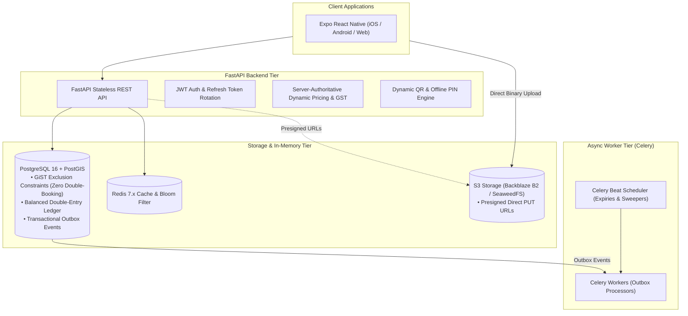

# Parkezy — Smart Parking Marketplace & Management Platform

[](https://fastapi.tiangolo.com)
[](https://expo.dev)
[](https://reactnative.dev)
[](https://www.postgresql.org)
[](https://redis.io)
[](https://docs.celeryq.dev)

**Parkezy** is an enterprise-grade, two-sided parking marketplace and real-time bay management platform. It connects urban drivers searching for guaranteed parking with private homeowners and commercial garage hosts monetizing vacant spaces.

---

## Repository Structure

This repository is organized into two primary folders:

```
├── parkezy-innotech/     <-- Production Full-Stack Application (Active)
│   ├── backend/          FastAPI, PostgreSQL/PostGIS, Redis, Celery workers
│   ├── mobile/           Cross-platform Expo React Native app (iOS/Android/Web)
│   ├── infra/            Infrastructure configs & deployment specs
│   ├── docs/             Architecture Decision Records (ADRs) & specs
│   ├── system-design-notes/ Comprehensive distributed systems notes
│   ├── docker-compose.yml Local infrastructure stack (Postgres, Redis, S3, Mailpit)
│   └── README.md         Detailed product guide, flowcharts & API reference
│
└── parkezy-2.0/          <-- Legacy Project Archive
    ├── parkezy/          Original native iOS SwiftUI codebase & Xcode project
    ├── parkezy_audit_report.md Architecture audit report
    └── SUBMISSION_CHECKLIST.md Historical submission notes
```

> **Full Documentation**: For all 5 system flowcharts (Driver Lifecycle, Host Onboarding, QR Access, Double-Entry Ledger, and Transactional Outbox), comprehensive feature matrices, and architecture breakdowns, see **[`parkezy-innotech/README.md`](./parkezy-innotech/README.md)**.

---

## High-Level System Architecture



---

## Key Product Features

### For Drivers
- **Interactive Geospatial Map**: PostGIS-powered spatial search (`ST_DWithin`) with radius filtering, cluster markers, and metro quick-jumps (Delhi NCR, Bengaluru, Mumbai).
- **Smart Filtering**: Filter by EV charging slots, covered/indoor parking, CCTV surveillance, security guards, and wheelchair access.
- **Real-Time Slot Layout**: Visual floor picker and vehicle sizing (Compact, Sedan, SUV, EV).
- **Server-Authoritative Pricing**: Instant transparent breakdown of base price, surge, 18% GST, and platform fees.
- **Dual Payment Options**: Seamless Razorpay online checkout or pay-at-venue (cash/offline UPI).
- **Digital Access Pass**: Dynamic rotating QR codes with 120-second nonces to eliminate replay attacks, plus offline 6-digit backup PINs.
- **Active Session Dashboard**: Live countdown timer, automated overstay tracking (₹20 / 15 mins), and one-tap extension.

### For Hosts & Garages
- **5-Step Listing Wizard**: Map pin-drop geocoding, multi-photo picker with direct-to-S3 presigned uploads, amenities selection, and access instructions.
- **Slot Inventory Management**: Custom slot tags (e.g. G-01, B2-14), floor numbers, and maintenance toggles.
- **Dynamic Pricing Engine**: Automated price recommendations based on 2 km neighboring averages.
- **Approval Modes**: Instant auto-accept mode or manual driver request review with 15-minute hold expiries.
- **Real-Time Earnings Analytics**: 14-day performance charts, lifetime earnings, occupancy metrics, and upcoming arrivals.
- **In-App Camera QR Scanner**: Fast gatekeeper scanner validating driver entries and exits with sub-100ms response times.

### Enterprise Reliability & Security
- **Zero Double-Booking**: Native database-level GiST exclusion constraint (`EXCLUDE USING gist (slot_id WITH =, period WITH &&)`).
- **Double-Entry Financial Ledger**: Balanced debit/credit ledger (`ledger_entries`) verified by database triggers.
- **Transactional Outbox Pattern**: Reliable at-least-once asynchronous event delivery without distributed transaction bottlenecks.
- **Bloom Filter Anti-Replay**: Instant Redis Bloom filter de-duplication of payment webhooks.
- **Direct S3 Uploads**: Mobile clients upload photos directly to object storage via presigned URLs.

---

## Quick Start (Local Development)

### 1. Launch Infrastructure
```bash
cd parkezy-innotech
docker compose up -d
```
Starts PostgreSQL/PostGIS (port `5434`), Redis (port `6380`), SeaweedFS S3 (port `8333`), and Mailpit (port `8025`).

### 2. Launch FastAPI Backend & Celery
```bash
cd backend
cp .env.example .env
uv sync
uv run alembic upgrade head

# Terminal 1: API Server (Swagger UI at http://localhost:8000/docs)
uv run uvicorn app.main:app --host 0.0.0.0 --port 8000 --reload

# Terminal 2: Celery Worker
uv run celery -A app.workers.celery_app worker --loglevel=INFO --concurrency=2

# Terminal 3: Celery Beat Scheduler
uv run celery -A app.workers.celery_app beat --loglevel=INFO
```

### 3. Launch Mobile Client
```bash
cd ../mobile
cp .env.example .env
npm install
npx expo start
```
- Press `w` to view the web preview.
- Scan the terminal QR code using the Expo Go mobile app.

---

## Automated Verification

```bash
# Run 66 integration tests against live PostGIS and Redis
cd parkezy-innotech/backend
uv run pytest

# Mobile type-checking
cd ../mobile
npx tsc --noEmit
```

---

## License

This project is licensed under the MIT License — see the [LICENSE](LICENSE) file for details.
