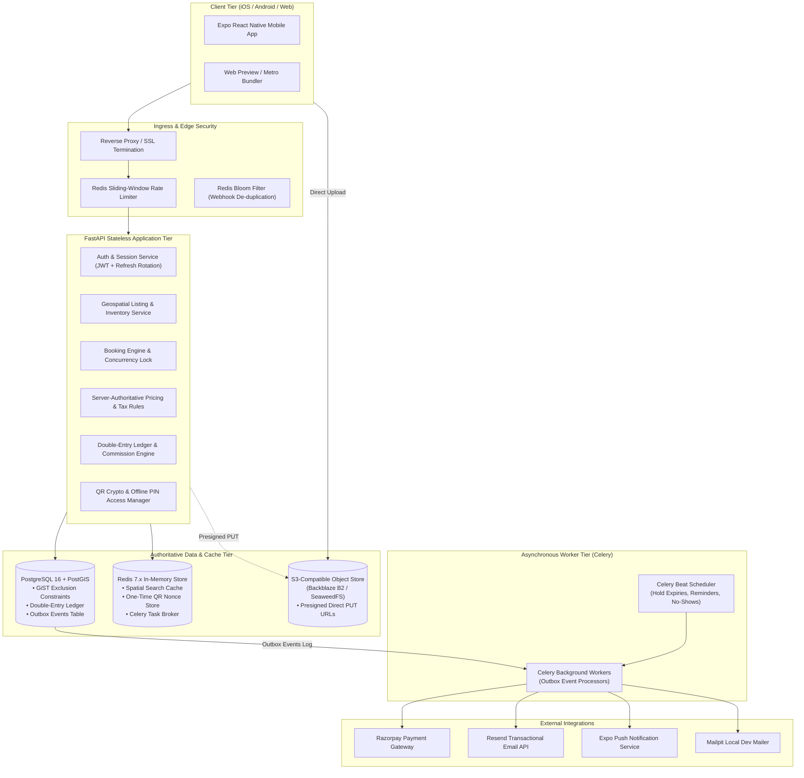
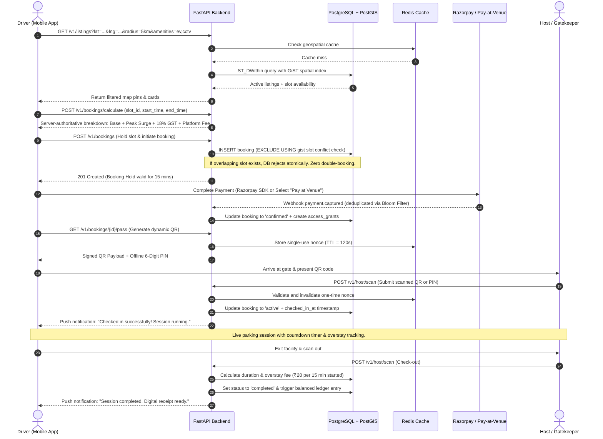
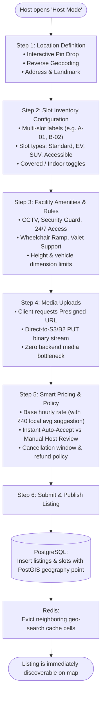
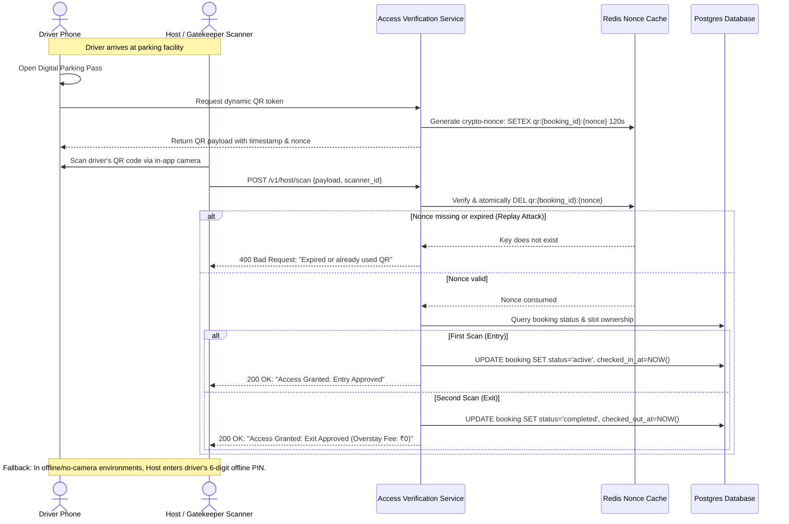
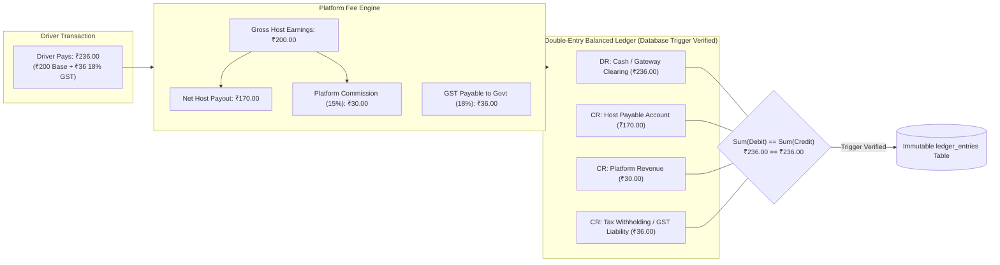
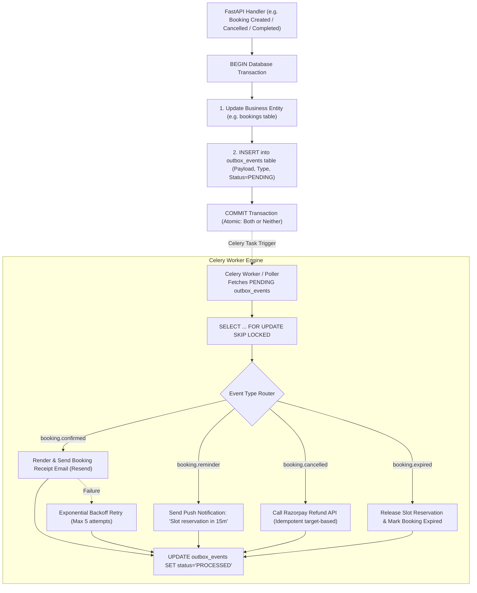
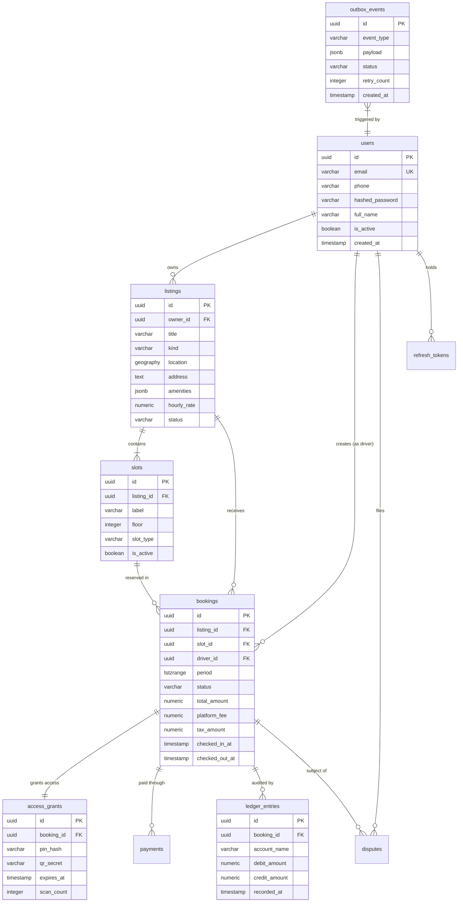

# Parkezy — Smart Parking Marketplace & Management Platform

[](https://fastapi.tiangolo.com)
[](https://expo.dev)
[](https://reactnative.dev)
[](https://www.postgresql.org)
[](https://redis.io)
[](https://docs.celeryq.dev)
[](https://www.docker.com)
[](https://www.typescriptlang.org)
[](https://www.python.org)

**Parkezy** is an enterprise-grade, two-sided parking marketplace and real-time bay management platform. It bridges urban drivers searching for guaranteed parking with private homeowners, commercial lots, shopping malls, and corporate garages wanting to monetize vacant parking spaces.

Built with a **zero double-booking mathematical guarantee** (PostgreSQL GiST exclusion constraints), **server-authoritative dynamic pricing & billing**, **double-entry financial ledger**, and a **contactless IoT/QR & PIN access engine**.

---

## Table of Contents
1. [Platform Architecture](#platform-architecture)
2. [End-to-End System Flowcharts](#end-to-end-system-flowcharts)
   - [1. Driver Booking & Parking Lifecycle](#1-driver-booking--parking-lifecycle)
   - [2. Host Listing & Inventory Onboarding](#2-host-listing--inventory-onboarding)
   - [3. Contactless QR / PIN Access & Validation](#3-contactless-qr--pin-access--validation)
   - [4. Double-Entry Accounting & Ledger Reconciliation](#4-double-entry-accounting--ledger-reconciliation)
   - [5. Transactional Outbox & Background Worker Pipeline](#5-transactional-outbox--background-worker-pipeline)
3. [Comprehensive Feature Inventory](#comprehensive-feature-inventory)
   - [Driver Experience](#driver-experience)
   - [Host Management Suite](#host-management-suite)
   - [Commercial Facilities & Garage Operations](#commercial-facilities--garage-operations)
   - [Security, Anti-Abuse & Reliability Engineering](#security-anti-abuse--reliability-engineering)
4. [Data Model & Database Schema](#data-model--database-schema)
5. [Technology Stack](#technology-stack)
6. [Local Development & Setup Guide](#local-development--setup-guide)
7. [Automated Verification & Benchmarks](#automated-verification--benchmarks)
8. [Production Deployment](#production-deployment)

---

## Platform Architecture



---

## End-to-End System Flowcharts

### 1. Driver Booking & Parking Lifecycle



---

### 2. Host Listing & Inventory Onboarding



---

### 3. Contactless QR / PIN Access & Validation



---

### 4. Double-Entry Accounting & Ledger Reconciliation



---

### 5. Transactional Outbox & Background Worker Pipeline



---

## Comprehensive Feature Inventory

### Driver Experience

| Feature | Description | Architecture / Implementation |
|---|---|---|
| **Interactive Geospatial Map** | Real-time map displaying commercial garages and private driveways with clustering and custom price badges. | Built with `react-native-maps` / Leaflet web fallback. PostGIS `ST_DWithin` spatial bounding queries with GiST index. |
| **Granular Amenity Filtering** | Instantly filter spots by EV Charging, Covered / Indoor, CCTV Surveillance, Security Guard, and Wheelchair Access. | Bitmask / JSONB indexed amenity filtering directly in PostgreSQL queries. |
| **Instant Metro Jump Navigation** | Quick-select buttons for high-density hubs (Delhi NCR / Ghaziabad, Bengaluru, Mumbai, Connaught Place, Cyber City). | Coordinated map camera animations with preset bounding coordinates. |
| **Dynamic Slot Grid & Floor Picker** | Visual floor-by-floor slot layout showing real-time slot statuses (Available, Reserved, Occupied, Maintenance). | Dynamic slot type cards (Compact, Sedan, SUV, EV, Accessible) with price multiplier modifiers. |
| **Flexible Booking Windows** | Choose between "Park Now" (immediate 15-minute start hold) or schedule future arrival dates and hours. | Multi-tier validation against host opening hours and blackout calendar windows. |
| **Server-Authoritative Pricing** | Transparent cost calculation breaking down base rate, peak-hour multiplier, GST (18%), and platform fees. | Computed on FastAPI backend (`/v1/bookings/calculate`); client never manipulates price variables. |
| **Dual Payment Methods** | In-app credit card / UPI / netbanking payment via Razorpay, or cash / offline UPI at venue. | Port-based gateway interface (`PaymentGateway`) supporting both online webhooks and offline settlement. |
| **Dynamic QR & Offline PIN Pass** | Tamper-proof, dynamic rotating QR code with single-use nonce (120s TTL) and backup 6-digit PIN. | In-memory Redis nonce expiration + cryptographically hashed PINs stored in `access_grants`. |
| **Live Session Dashboard & Timer** | Active parking session tracker showing live elapsed time, overstay fee counter, and one-tap extension. | Real-time countdown timer synchronized with server `checked_in_at` and `end_time` timestamps. |
| **Automated Overstay Protection** | Predictable, itemized billing for vehicle owners exceeding their reservation window (₹20 per started 15 min). | Automated overstay fee calculation executed server-side upon gatekeeper exit scan. |
| **Dispute Filing & Evidence** | Drivers can file complaints (blocked spot, hostile host, overcharge) with photo evidence. | Presigned direct S3 image upload with dedicated dispute audit records (`disputes` table). |
| **Digital Receipts & Ledger History** | Searchable history of active, past, and cancelled reservations with complete financial invoices. | PDF/HTML receipts rendered via server templates and downloadable in-app. |

---

### Host Management Suite

| Feature | Description | Architecture / Implementation |
|---|---|---|
| **Step-by-Step Listing Wizard** | Intuitive 5-step wizard: Geocoding Pin Drop → Media Upload → Details → Amenities → Review. | Client-side step validation with direct-to-S3 media upload avoiding server memory bottlenecks. |
| **Interactive Map Pin-Drop** | Hosts fine-tune exact driveway or garage entry coordinates on an interactive satellite/vector map. | High-accuracy latitude and longitude captured into PostGIS `geography(Point, 4326)`. |
| **Slot Inventory Configuration** | Multi-slot creation with floor labeling, custom bay names (e.g., G-01, B2-14), and vehicle capability tags. | Relational `slots` table linked via foreign key to parent `listings`, ensuring clean inventory integrity. |
| **Suggested Price Intelligence** | Recommends optimal hourly rates by computing average pricing of neighboring listings within a 2 km radius. | Real-time server-side geospatial spatial averaging endpoint (`/v1/host/suggested-price`). |
| **Instant vs Approval Modes** | Choose between instant auto-accept bookings or manual review of driver booking requests. | Built-in 15-minute timer for manual approvals before unconfirmed holds auto-expire. |
| **Real-Time Earnings Dashboard** | 14-day trailing performance chart, all-time net revenue, occupancy rates, and upcoming arrivals. | Optimized SQL aggregation across completed bookings; resilient empty-state visual tracks. |
| **In-App Camera QR Scanner** | Native camera barcode scanner for hosts and gatekeepers to validate incoming driver passes. | Built with `expo-camera`; decodes payload and calls `/v1/host/scan` with instant audio/haptic feedback. |
| **Offline PIN Verification** | Backup verification input for hosts when lighting is poor or driver camera screen is cracked. | Compares hashed PIN against active `access_grants` row in a constant-time cryptographic check. |
| **Host Booking Manager** | Filter reservations by Upcoming, Active, Completed, and Cancelled with one-tap host check-in/out. | Real-time list updates backed by TanStack Query optimistic invalidation. |

---

### Commercial Facilities & Garage Operations

| Feature | Description | Architecture / Implementation |
|---|---|---|
| **Multi-Floor Garage Layout** | Manage multi-tier garages (Basement 1, Ground, Floor 1, Rooftop) with separate slot quotas. | Hierarchical layout query modeling facilities and slots with floor sorting attributes. |
| **Gatekeeper Fast-Track Mode** | Streamlined check-in/out interface designed for continuous, rapid entry scanning during rush hours. | Sub-100ms API response time powered by Redis-cached active reservation lookups. |
| **Dynamic Surge Pricing Rules** | Configure weekend surcharges, event day multipliers, and commercial peak-hour rates. | Configured via `platform_settings` table and dynamic host pricing multipliers. |

---

### Security, Anti-Abuse & Reliability Engineering

| Feature | Description | Architecture / Implementation |
|---|---|---|
| **Zero Double-Booking Guarantee** | Prevents multiple drivers from reserving the same bay at the same time, even under extreme load. | PostgreSQL GiST exclusion constraint: `EXCLUDE USING gist (slot_id WITH =, period WITH &&)`. |
| **Double-Entry Financial Ledger** | Every financial transaction is recorded with balanced debit and credit entries verified by DB triggers. | `ledger_entries` table ensuring total debits exactly equal total credits at all times. |
| **Transactional Outbox Pattern** | Guarantees reliable delivery of emails, push notifications, and webhooks without lost messages. | Database writes commit entity changes and outbox rows in a single atomic ACID transaction. |
| **Sliding-Window Rate Limiting** | Protects sensitive endpoints (auth, SMS OTP, booking holds) from brute force and denial of service. | Redis-backed sliding-window rate limiter checking caller IP and user token. |
| **Bloom Filter Webhook Idempotency** | Prevents payment replay attacks and duplicate webhook executions from Razorpay. | Redis Bloom filter backed by a unique database constraint on `idempotency_key`. |
| **Rotating Refresh Token Security** | High-security JWT authentication with rotating refresh tokens and automatic reuse detection. | If a used refresh token is presented again, the entire user token family is immediately revoked. |
| **Direct-to-Storage Presigned URLs** | Media files (listing photos, dispute evidence) upload directly from mobile device to S3/B2. | Secure presigned PUT URLs with byte-size and MIME-type restrictions. Zero server upload proxying. |

---

## Data Model & Database Schema



---

## Technology Stack

| Layer | Technologies Used | Key Responsibilities |
|---|---|---|
| **Mobile App (Frontend)** | React Native, Expo SDK 57, Expo Router, TypeScript, TanStack Query, `react-native-reanimated` | Cross-platform iOS/Android app, tab navigation, interactive map, camera QR scanner, responsive layouts. |
| **API Application Tier** | Python 3.12, FastAPI, Pydantic v2, SQLAlchemy 2.0 (Async), Alembic | Stateless REST API, request validation, business rules, pricing engine, JWT auth, exception handlers. |
| **Geospatial & Storage** | PostgreSQL 16, PostGIS, GiST Indexes | ACID storage, geospatial queries (`ST_DWithin`, `ST_Distance`), native exclusion constraints. |
| **Caching & In-Memory** | Redis 7.x, Redis Bloom Filter | Geospatial query cache, one-time QR nonces, sliding-window rate limiters, Celery task broker. |
| **Asynchronous Engine** | Celery 5.4, Celery Beat | Transactional outbox polling, reservation hold cleanup, overstay monitoring, push and email dispatch. |
| **Object Storage** | S3-Compatible API (Backblaze B2, SeaweedFS) | Secure presigned direct PUT uploads for listing photos and dispute evidence. |
| **Communication & Notifications** | Resend API, Expo Push Service, Mailpit | Transactional receipts, booking status emails, mobile push alerts. |
| **Payment Gateway** | Razorpay SDK, Offline Pay-at-Venue | Card/UPI payment capture, automatic webhook signature verification, target-based refunds. |
| **Testing & Quality** | Pytest, Ruff, TypeScript (`tsc`), Expo Doctor, Locust / Async Benchmarks | 66+ full integration tests against real PostGIS/Redis instances, linting, latency benchmarks. |

---

## Local Development & Setup Guide

### Prerequisites
- [Docker](https://www.docker.com/) & Docker Compose
- [Python 3.12+](https://www.python.org/) with [uv](https://docs.astral.sh/uv/) package manager
- [Node.js 20+](https://nodejs.org/) & npm

### 1. Launch Development Infrastructure
Start PostgreSQL with PostGIS, Redis, SeaweedFS S3, and Mailpit email catcher:
```bash
docker compose up -d
```

Verify services:
- **PostgreSQL / PostGIS**: `localhost:5434`
- **Redis**: `localhost:6380`
- **SeaweedFS S3**: `http://localhost:8333`
- **Mailpit Web Mailbox**: `http://localhost:8025`

### 2. Backend API & Workers
```bash
cd backend

# Setup environment variables
cp .env.example .env
# Set secure keys in .env:
# JWT_SECRET=your-random-32-char-secret
# ACCESS_CODE_SECRET=your-random-access-secret

# Install dependencies and run migrations
uv sync
uv run alembic upgrade head

# Start FastAPI API Server (Terminal 1)
uv run uvicorn app.main:app --host 0.0.0.0 --port 8000 --reload

# Start Celery Outbox Worker (Terminal 2)
uv run celery -A app.workers.celery_app worker --loglevel=INFO --concurrency=2

# Start Celery Beat Scheduler (Terminal 3)
uv run celery -A app.workers.celery_app beat --loglevel=INFO
```
Interactive API Swagger documentation is available at: **`http://localhost:8000/docs`**

### 3. Mobile Client (Expo React Native)
```bash
cd ../mobile

# Setup environment variables
cp .env.example .env
# For physical phone testing over LAN, set:
# EXPO_PUBLIC_API_URL=http://<YOUR_LOCAL_IP>:8000

# Install dependencies and launch Metro Bundler
npm install
npx expo start
```
- Press `w` to open the Web preview in your browser.
- Scan the printed QR code using the **Expo Go** app on your iOS or Android device.

---

## Automated Verification & Benchmarks

The codebase includes comprehensive automated test suites covering concurrency, double-booking prevention, auth rate-limiting, and financial integrity:

```bash
# Backend test suite (66 integration tests against live PostGIS & Redis)
cd backend
uv run pytest

# Code formatting and linting
uv run ruff check . && uv run ruff format --check .

# Concurrency & latency benchmark (2,000 seeded listings)
PYTHONPATH=. uv run python scripts/bench.py --seed-listings 2000
PYTHONPATH=. uv run python scripts/bench.py --cleanup

# Mobile type-checking and health checks
cd ../mobile
npx tsc --noEmit
npx expo lint
npx expo-doctor
```

### Verified Test Scenarios:
1. **12 Concurrent Booking Requests**: Exactly 1 request succeeds; 11 are rejected atomically by the GiST exclusion constraint without race conditions.
2. **Replay Rejection on QR Scans**: Single-use nonces are invalidated upon consumption; repeated scans return rejection errors.
3. **Double-Entry Ledger Balancing**: Every booking transaction creates matching debit and credit entries verified by database triggers.
4. **Idempotent Webhooks**: Re-sent payment webhooks are discarded via Redis Bloom filters without duplicate booking side-effects.
5. **Session Expiration Sweeper**: Celery beat accurately marks unconfirmed holds as expired after 15 minutes.

---

## Production Deployment

| Component | Recommended Free/Cost-Effective Cloud Hosting | Deployment Instructions |
|---|---|---|
| **API Backend** | Render / Fly.io / Railway | Deploy using [`backend/Dockerfile`](./backend/Dockerfile). Set `APP_ENV=production`, `TRUST_FORWARDED_FOR=true`. Migrations run automatically on container startup. |
| **Celery Workers & Beat** | Render Background Worker / Fly.io Machines | Deploy the same container image with command `celery -A app.workers.celery_app worker` and a single instance running `celery -A app.workers.celery_app beat`. |
| **PostgreSQL + PostGIS** | Neon / Supabase (Compute only) | Neon Serverless Postgres (0.5 GB free tier, does not hibernate permanently). |
| **Redis Cache** | Upstash / Redis Cloud | Redis Cloud Essentials (30 MB free tier) or Upstash Serverless Redis. |
| **Object Storage** | Backblaze B2 (S3 API) | 10 GB free tier. Keep bucket private and configure CORS to allow mobile `PUT` uploads. |
| **Mobile App** | EAS Build (Expo Application Services) | Run `npx eas build --platform all` to create standalone `.apk` / `.aab` / `.ipa` builds. |

---

## License

This project is licensed under the MIT License — see the [LICENSE](LICENSE) file for details.
