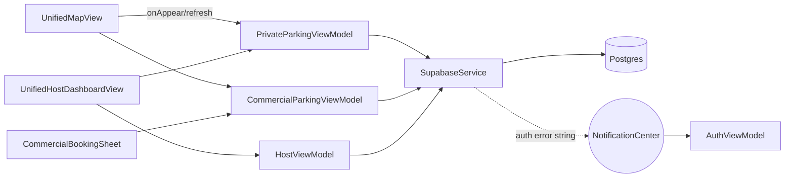

# Component Architecture

## Components
| ID | Component | Files | Responsibility | Owns state | Depends on |
|---|---|---|---|---|---|
| C-01 | App shell | `parkezyApp.swift`, `Backend/AppDelegate.swift` | Create 6 `@StateObject` VMs, gate on `isAuthenticated`, overlay offline banner, restore session | VM lifetimes | all VMs |
| C-02 | Auth | `Backend/AuthViewModel.swift`, `AuthenticationView.swift` | Email/Apple auth, session restore, profile caching, account ops | `isAuthenticated`, `currentUser`, errors | C-04, Supabase Auth |
| C-03 | Supabase config | `Backend/SupabaseConfig.swift`, `Backend/AppConfig.swift` | Hard-coded URL + anon key, shared `SupabaseClient`; `AppConfig` is dead | — | supabase-swift |
| C-04 | Data service | `Backend/SupabaseService.swift` | 22 async CRUD wrappers over PostgREST; swallow errors → `nil`/`[]`/`false`; detect session expiry by string match | none (singleton) | C-03 |
| C-05 | Map VM (legacy) | `MapViewModel.swift` | `parking_spots`, search geocoding, user location → distances | spots, filters | C-04, C-09 |
| C-06 | Commercial VM | `CommercialParkingViewModel.swift` | Facilities, driver bookings, optimistic slot occupancy, 60 s `objectWillChange` timer | facilities, bookings | C-04 |
| C-07 | Private VM | `PrivateParkingViewModel.swift` (548 lines) | Listings, my listings, host requests, booking create/approve/reject, listing CRUD, suggested prices, **demo-data generators** | listings, bookings, currentUser | C-04 |
| C-08 | Booking VM (legacy) | `BookingViewModel.swift` | Single-session lifecycle, timer, overstay, geofence reactions, live-activity stubs | activeSession | C-04, C-09, C-10 |
| C-09 | Location | `LocationManager.swift` | CLLocationManager wrapper, geofences, notification names | user location, regions | CoreLocation |
| C-10 | Notifications | `NotificationManager.swift` | Local notification scheduling | — | UserNotifications |
| C-11 | Host VM | `HostViewModel.swift` | Dashboard metrics, QR validation, chart data | host stats | C-04, C-12 |
| C-12 | QR | `QRCodeService.swift` | Generate/parse QR payloads (unsigned) | — | CoreImage |
| C-13 | Connectivity | `Backend/NetworkMonitor.swift`, `Components/StandardStateViews.swift` | NWPathMonitor + offline banner + state views | `isConnected` | Network |
| C-14 | UI kit | `DesignSystem.swift`, `SkeletonView.swift` | Tokens, shimmer | — | SwiftUI |
| C-15 | Domain models | `ParkingSpot`, `BookingSession`, `PrivateParking`, `CommercialParking`, `DisputeReport`, `Backend/AppUser` | Codable DTOs *and* UI helpers (colors/icons) mixed together; custom Codable mapping lat/lng ↔ coordinate | — | — |
| C-16 | Platform extras (inert) | `ParkingLiveActivity`, `ParkingWidget`, `FindParkingIntent` | ActivityKit/WidgetKit/App Intents code with no extension target | — | — |
| C-17 | Mock data (dead) | `MockDataService.swift` | Delhi sample spots | — | — |

## Key interactions

## State ownership and lifecycle
All six VMs live for the whole app lifetime (created in `ParkezyApp`), including across logout. `Timer`s in C-06/C-07 fire every 60 s forever. VMs call `SupabaseConfig.client.auth.session` ad hoc to learn the user id instead of receiving it from `AuthViewModel` (duplicate sources of truth: `AuthViewModel.currentUser`, `PrivateParkingViewModel.currentUser`, `HostViewModel.currentHost`).

## Concurrency
`@MainActor` everywhere (also default isolation). Async work is launched with unstructured `Task {}`; no cancellation, no retry, no serialization of writes. `DispatchQueue.main.asyncAfter` is used to fake latency.

## Error handling and logging
Errors are `print`ed (emoji-prefixed) and converted to empty results. No logger, no telemetry. Inconsistent surface: `errorMessage` exists on VMs but is rarely displayed.

## Coupling and duplication hot-spots
- Models double as view helpers (colors/icons) → hard to share with other targets.
- `PrivateParkingViewModel` mixes data access, business rules, demo generators, and suggestion math.
- Unreachable or dead code ≈ 39% of lines (≈6.2k of 15.9k) (see [codebase-map](codebase-map.md)).
