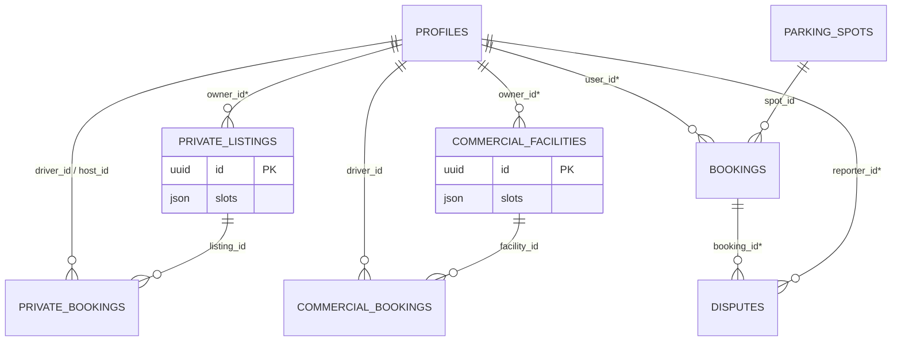

# Data Architecture

> **Evidence level: PARTIAL.** `supabase_schema.sql` was committed once (`e72c855`, 2026-05-22; deleted in `02b8530`) and is recoverable with `git show e72c855:supabase_schema.sql`. It defines **5 of the 8 tables the app uses** (`profiles`, `private_listings`, `commercial_facilities`, `bookings`, `disputes`) with RLS policies and the profile trigger. It was authored *before* the final app commit and **not live-verified**: `parking_spots`, `private_bookings` and `commercial_bookings` have **no DDL anywhere in git** (must have been created by hand in the Supabase dashboard or not at all — existence unknown), and `disputes.photo_urls` is absent from that DDL although the app sends it. A read-only inspection of the live project through the Supabase MCP failed on database authentication four times (project reported *hibernated*), so live state is **unknown**. Verified fact: the project exposes **zero Edge Functions**. **First action of the rebuild: export the real schema** (see [M-00](../rebuild/implementation-roadmap.md)).

## Committed DDL (e72c855) vs what the app does
| Table | In committed DDL? | Key DDL facts | Mismatch with app code |
|---|---|---|---|
| `profiles` | Yes | `id uuid` FK → `auth.users` (no cascade); `capabilities`/`stats` JSONB with defaults; RLS: **SELECT `using (true)` (everyone, including anon, reads email + phone)**, INSERT/UPDATE own row (UPDATE has no `WITH CHECK`/column limit → self-escalation of `capabilities`/`stats`), **no DELETE policy**; trigger `on_auth_user_created` → `handle_new_user()` (SECURITY DEFINER, no `search_path`) | `deleteAccount` deletes via RLS → 0 rows affected, silently (SEC-05) |
| `private_listings` | Yes | FK `owner_id` → `profiles`; `available_days`/`image_urls` JSONB; RLS: SELECT true; `FOR ALL using (auth.uid() = owner_id)`; indexes on `owner_id`, `(lat,lng)` | — |
| `commercial_facilities` | Yes | FK `owner_id`; same RLS pattern → **any signed-in user can insert a "commercial facility"** (no capability check) | UI never writes it |
| `bookings` | Yes | **`type text NOT NULL`**; `user_id` FK; RLS: select/insert/update own rows only (UPDATE has no `WITH CHECK` → driver can rewrite `total_cost`/`status`); hosts have **no** read policy (comment in SQL says so) | `BookingSession` DTO has no `type` key → **inserts violate NOT NULL** (legacy flow fails at DB; `getPrivateBookings` filters on `type`) |
| `disputes` | Yes | FK `booking_id`, `reporter_id`; select/insert own; **no `photo_urls` column**; `status` default `'pending'` | DTO sends `photo_urls` → PostgREST error (insert fails unless altered later); sends "Pending" casing |
| `parking_spots` | **No** | — | Used by `MapViewModel`, `BookingViewModel` |
| `private_bookings` | **No** | — | Used by `PrivateParkingViewModel` (host requests) |
| `commercial_bookings` | **No** | — | Used by `CommercialParkingViewModel` (the only reachable booking write) |

If the last three tables do not exist live, F-24, F-26/F-44 and the legacy map data are **Broken**, not just partial.

## Tables the client touches (columns from Swift `CodingKeys`; types/constraints from committed DDL where available)
| Table | Used by (service method) | Writes from client | Columns (from `CodingKeys`) |
|---|---|---|---|
| `profiles` | `getUserProfile`, `updateUserProfile`, `deleteAccount` | update, delete | `id` (text in Swift; auth uid), `email`, `name`, `phone_number`, `profile_image_url`, `created_at`, `capabilities` (JSON `{canDrive,canHostPrivate,canHostCommercial}` — note camelCase keys), `stats` (JSON `{totalBookingsAsDriver,hostRating,totalEarnings}`) |
| `private_listings` | `getAllPrivateListings`, `getMyPrivateListings`, `create/update/deletePrivateListing` | insert/update/delete | `id`, `owner_id`, `owner_name`, `title`, `address`, `lat`, `lng`, `description`, `slots` (JSON array of `{id,slotNumber,slotLabel,vehicleSize,canFitSUV,canFitBike,isOccupied,isDisabled,currentBookingID,bookingEndTime}`), `hourly_rate`, `daily_rate`, `monthly_rate`, `flat_full_booking_rate`, `auto_accept_bookings`, `instant_booking_discount`, `has_cctv`, `is_covered`, `has_ev_charging`, `has_security_guard`, `has_water_access`, `is_24_hours`, `available_from`, `available_to`, `available_days` (int[]), `rating`, `review_count`, `image_urls`, `max_booking_duration` (enum string), `suggested_hourly_rate` |
| `commercial_facilities` | `getAllCommercialFacilities`, `getNearbyFacilities` | **none** (read-only) | `id`, `name`, `address`, `lat`, `lng`, `facility_type`, `slots` (JSON of `{id,slotNumber,slotType,floor,isOccupied,isDisabled,currentBookingID,bookingEndTime,hourlyRateOverride}`), `default_hourly_rate`, `flat_day_rate`, `has_cctv`, `has_ev_charging`, `has_valet_service`, `has_car_wash`, `is_24_hours`, `rating`, `review_count`, `owner_id`, `owner_name` |
| `commercial_bookings` | `createCommercialBooking`, `getCommercialBookings(driverID)` | insert | `id`, `facility_id`, `slot_id`, `driver_id`, `booking_time`, `scheduled_start_time`, `scheduled_end_time`, `actual_start_time`, `actual_end_time`, `hourly_rate`, `estimated_duration`, `estimated_cost`, `actual_cost`, `vehicle_number`, `vehicle_type`, `status`, `access_code` |
| `private_bookings` | `createPrivateBookingRequest`, `getPrivateBookingRequests(hostID)`, `updatePrivateBookingRequest` | insert/update | `id`, `listing_id`, `slot_id`, `driver_id`, `host_id`, `driver_name`, `driver_phone`, `vehicle_number`, `request_time`, `scheduled_start_time`, `scheduled_end_time`, `actual_*_time`, `duration_type`, `agreed_rate`, `estimated_cost`, `actual_cost`, `host_earnings`, `status`, `approval_time`, `rejection_reason`, `access_pin`, `driver_message`, `host_message` |
| `parking_spots` (legacy) | `getParkingSpots`, `updateParkingSpotOccupancy` | update `is_occupied` | `id`, `address`, `lat`, `lng`, `type`, `price_per_hour`, `has_cctv`, `is_covered`, `has_ev_charging`, `is_accessible`, `is_24_hours`, `has_insurance`, `is_occupied`, `rating`, `review_count`, `access_pin` |
| `bookings` (legacy) | `create/updateBookingSession`, `getBookingSessions`, `getPrivateBookings` | insert/update | `id`, `spot_id`, `user_id`, `booking_time`, `scheduled_start_time`, `actual_start_time`, `scheduled_end_time`, `actual_end_time`, `duration`, `total_cost`, `overstay_fee`, `status`, `access_code`. `getPrivateBookings` also filters `type = 'private'`, a column **absent from the DTO** (existence unknown) |
| `disputes` | `createDispute` | insert | `id`, `booking_id`, `reporter_id`, `reason`, `description`, `photo_urls`, `status`, `created_at`, `resolved_at`, `resolution_notes` |

Edge cases in mapping: coordinates are stored as `lat`/`lng` doubles (no PostGIS; `getNearbyFacilities` is an unfiltered `select`). Status enums are stored as **display strings** ("Pending Approval", "Mall Parking", "24 Hours") — brittle for filtering/localization. Slots are embedded JSON, so occupancy cannot be enforced by constraints.

## ER diagram (FKs marked * are in the committed DDL; others inferred)

Slot ids inside `slots` JSON are referenced by `slot_id` in the booking tables **without** any relational integrity.

## Lifecycle, ownership, caching
- Client generates UUIDs for new rows. Rows are inserted whole (`insert(encodable)`), so the client decides every column, including `rating`, `review_count`, `owner_name`, `suggested_hourly_rate`, costs, PINs.
- No local persistence/caching (no SwiftData/CoreData/UserDefaults for domain data). Offline = banner only.
- Deletion: listings hard-deleted by id; account deletion deletes the `profiles` row only (cascade behavior unknown). No soft delete/audit.
- Triggers: `on_auth_user_created` → `handle_new_user()` creates the profile (committed DDL, live state unverified).
- Transactions/invariants: none; booking = independent insert, slot occupancy updated only in client memory.

## Migration history
The only Supabase schema artifact in git is the single `supabase_schema.sql` commit above (no later migrations). Git history shows two earlier backends: **Firebase** (client SDK, `GoogleService-Info.plist` tracked in history) and a **Django REST backend** (`backend/`, `API_DOCUMENTATION.md`; relational `ParkingSpot`, `CommercialParkingFacility`, private listing and booking models with owner FKs, `access_pin`, `daily_rate`, `monthly_rate`), removed in commit `35be30d` (2026-03-17). Supabase replaced them on 2026-05-22 (commit `eec6098`, message: "sql query done on supabase website"), i.e. the live schema was pasted into the Supabase SQL editor; later changes (three more tables) were never committed. The Django models are the best surviving hint of the originally intended relational design (`git show 35be30d^:backend/parking/models.py`).

## Rebuild guidance
See [target-architecture](../rebuild/target-architecture.md): normalized `slots` table, `timestamptz`, enums as Postgres enums or lookup tables, PostGIS `geography(Point)`, server-computed pricing, exclusion constraint against overlapping bookings, migrations in `supabase/migrations`.
