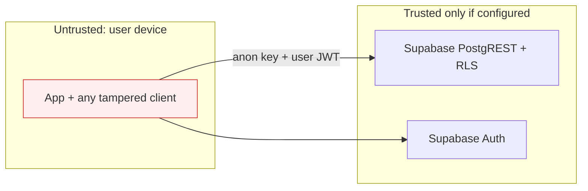

# Security and Trust Boundaries

## Trust model

**Critical invariant:** because there is no server code, **RLS policies are the only security boundary**, and the app is a fully untrusted client. The anon key is public by design (verified: decoded JWT claims show `role = anon`, not `service_role`). Everything the client computes (price, status, PIN, occupancy, capabilities, earnings) can be forged by calling PostgREST directly unless RLS/constraints/triggers forbid it. RLS is known only from the historical DDL (`e72c855`, 5 of 8 tables) and the live DB was unreachable, so each access-control item below is *confirmed against historical DDL* or *needs validation* as labelled.

## Secrets and configuration
- `Backend/SupabaseConfig.swift` hard-codes the project URL and anon key (acceptable by design, but cannot be rotated per environment; no dev/staging/prod split; `AppConfig.useSupabase` is dead).
- No service-role key, no private key, no `.env` found in the working tree. Git-history scan (counts only, no values printed): `SECRET_KEY` appears in `backend/parkezy_backend/settings.py` in commits `226f9d5`, `35be30d` (legacy Django); `GoogleService-Info.plist` was tracked under `Parkezy/Parkezy/Backend/`; one JWT-shaped string exists in `64c4240` (the anon key, in `SupabaseConfig.swift`). No `service_role` or `sb_secret` strings in history.
- `.claude/settings.local.json` is tracked although `.gitignore` lists it (contains only harmless allow-rules).

## Findings summary (details in [audit-findings](../quality/audit-findings.md))
| Area | Result |
|---|---|
| AuthN | Supabase Auth; Apple nonce correct; no entitlement (SEC-07); sign-up/confirmation handling weak (BUG-09) |
| AuthZ | Client-only role gating, none actually used; **self-grant of `capabilities`/`stats` permitted by historical `profiles` UPDATE policy** (SEC-02); `profiles` (email, phone) world-readable (SEC-11) |
| Access codes | PIN stored in `parking_spots.access_pin` (readable to all browsers) and `private_bookings.access_pin`; client-generated with non-crypto RNG; hard-coded fallback PIN (SEC-03) |
| QR | Unsigned `id:id` strings; forgeable (SEC-04) |
| Input validation | Client-side only; free text (title, description, messages) inserted directly; no length limits (SEC-08) |
| Account deletion | Deletes profile row only; Auth identity and related data remain; flow is also unreachable/non-compiling (SEC-05) |
| Transport | HTTPS URL; no ATS exceptions found; no certificate pinning |
| Local storage | Auth tokens handled by supabase-swift (Keychain by default in recent versions — **verify**); no other secrets stored |
| Logging | `print` of IDs and error descriptions (could include PostgREST messages) |
| Privacy | Driver phone number copied into `private_bookings.driver_phone`; host `owner_name` denormalized into public listings; no privacy policy URL (placeholder) |
| Supply chain | One SPM dependency (supabase-swift 2.46.0, `Package.resolved` pinned; deployment target iOS 26.5 narrows install base) |

## Required safeguards for the rebuild
1. RLS enabled on every table with explicit deny-by-default policies and tests ([T-30..](../quality/testing-strategy.md)).
2. Column-level protection for `capabilities`, `stats`, `rating`, prices, statuses; mutate via `SECURITY DEFINER` RPCs.
3. Server-issued, short-lived, signed access tokens (QR) and server-verified PINs with attempt throttling.
4. Account deletion through an Edge Function using the service role (never shipped in the app).
5. Per-environment config via `.xcconfig`; secrets never in source.
