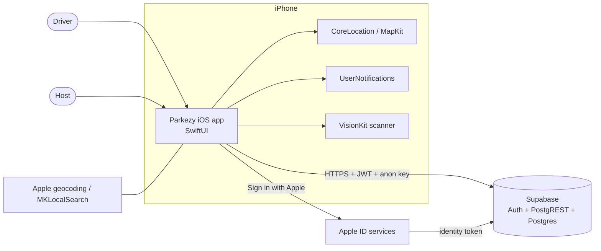
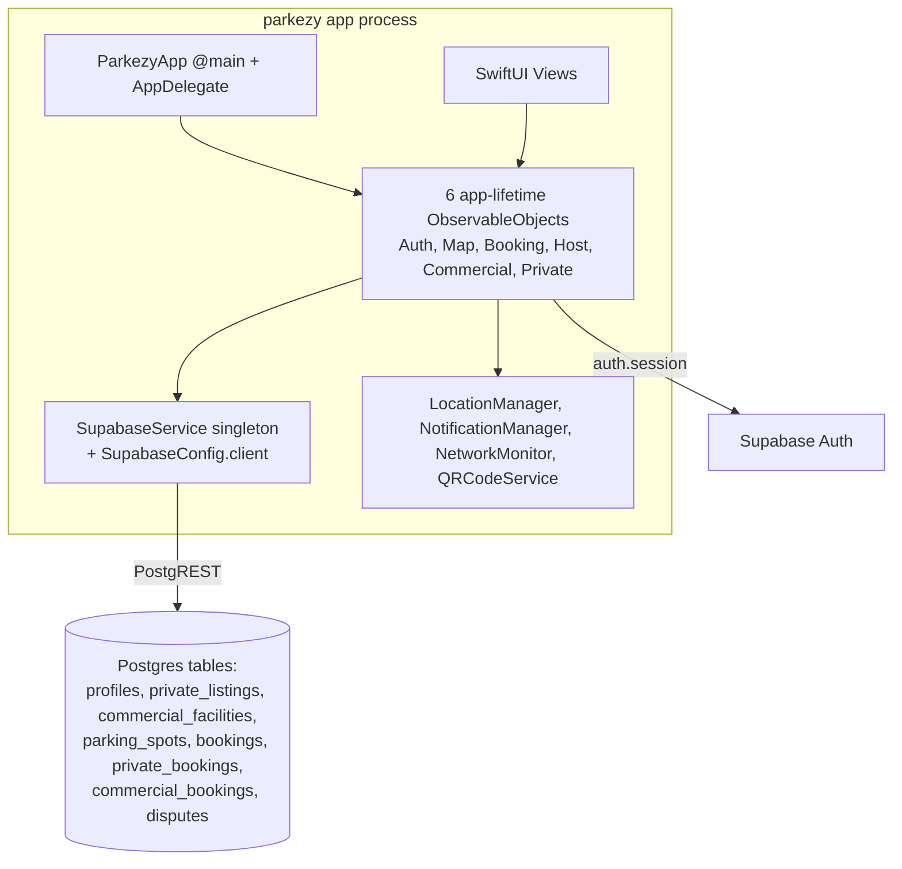

# System Overview

**Current implementation:** a single-target native iOS app (SwiftUI, Swift 5 language mode, `SWIFT_DEFAULT_ACTOR_ISOLATION = MainActor`, deployment target **iOS 26.5**) talking directly to **Supabase** (Auth + PostgREST) with the public anon key. There is **no custom server code** in the repo: no Edge Functions (`list_edge_functions` returned an empty list), no SQL/migrations, no CI.

Verified runtime/compile facts: one Xcode target `parkezy` (bundle id `K2976.parkezy`), generated Info.plist, SPM package `supabase-swift 2.46.0` (modules Auth, Functions, PostgREST, Realtime, Storage, Supabase). Realtime, Storage and Functions are linked but unused.

## System context

Not present: payment gateway, SMS/push provider, image storage, analytics, crash reporting, admin console.

## Containers / runtime components

Five tables have committed DDL (git history `e72c855`); `parking_spots`, `private_bookings`, `commercial_bookings` are inferred from client queries only. Live state is unverified ([data-architecture](data-architecture.md)).

## Architectural patterns actually used
- MVVM with `@EnvironmentObject` injection from the App struct; one shared `SupabaseService` singleton (`@MainActor`).
- Optimistic local mutation followed by fire-and-forget `Task { await service... }` (results ignored) — **dominant pattern, and the main correctness risk**.
- Slots embedded as JSON arrays inside parent rows (`slots` in `private_listings`/`commercial_facilities`) rather than a `slots` table.
- Notification-based cross-layer signaling (session expiry, geofence events).

## Inconsistencies
1. Two parallel domain models: legacy `ParkingSpot`/`BookingSession` vs `PrivateParking*`/`Commercial*` (three `bookings` tables).
2. View models are created at app start (before login) and fetch immediately; they are never reset on sign-out.
3. `HostViewModel` mixes driver-style `BookingSession` data with the host's private bookings.
4. Duplicate UI: `LocationPickerView` vs `LocationStepView`; `PrivateListingDetailView` vs `EnhancedPrivateListingDetailView`.
5. Docs/code mismatch on Live Activities, iOS target, file lists ([current-state](../state/current-state.md#legacy-documentation-discrepancies)).
