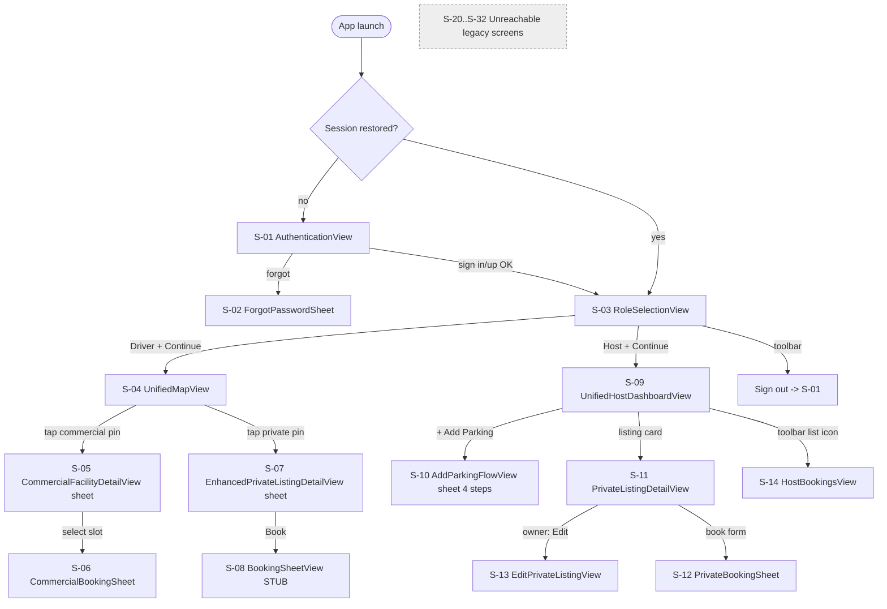

# UI/UX Inventory

**Visual inspection was not performed.** Everything below is derived from SwiftUI source; items needing on-device/simulator verification are marked **[visual]**. Screens are in `parkezy/parkezy/`.

## Navigation overview

## Reachable screens
| ID | Screen / file | Purpose | Entry → Exit | Key data & source | States handled | Features | Notes |
|---|---|---|---|---|---|---|---|
| S-01 | `AuthenticationView` | Sign in / create account / Apple | launch (unauth) → S-03 | `AuthViewModel` | inline error text, loading spinner, form disabled while loading | F-01 F-02 | Toggle sign-in/up; Apple button; "Forgot Password?" |
| S-02 | `ForgotPasswordSheet` (same file) | Send reset email | S-01 sheet → dismiss | email | sent confirmation | F-04 | No recovery handling |
| S-03 | `RoleSelectionView` | Pick Driver/Host mode, sign out | after auth → S-04/S-09 | none | — | F-10 F-05 | Full-bleed `parking_city_bg` image **[visual]** |
| S-04 | `UnifiedMapView` | Map of supply + search + chips + stats bar | S-03 → S-05/S-07 | `CommercialParkingViewModel.facilities`, `PrivateParkingViewModel.listings` | no loading/empty/error state; silent empty on fetch failure | F-20–F-22 | Pull-to-refresh; no list view alternative |
| S-05 | `CommercialFacilityDetailView` | Floors, slot grid, amenities | S-04 sheet | facility slots | — | F-23 | Slot occupancy from embedded JSON |
| S-06 | `CommercialBookingSheet` | Duration stepper (1–24 h, 0.5 step), start now/scheduled, cost incl. GST | S-05 | computed cost | spinner, success view | F-24 | Success shows placeholder QR icon |
| S-07 | `EnhancedPrivateListingDetailView` | Listing detail, slot cards | S-04 sheet | listing | 3 s fake skeleton | F-25 | Owner detection via `myListings` |
| S-08 | `BookingSheetView` | — | S-07 | — | — | F-26 | "Full booking flow coming soon!" |
| S-09 | `UnifiedHostDashboardView` | Host home | S-03 | `PrivateParkingViewModel`, `HostViewModel` | empty states for listings/active | F-40 | Earnings tiles show wrong-source data |
| S-10 | `AddParkingFlowView` (+`LocationStepView`, `MediaStepView`, `DetailsStepView`, `ReviewStepView`) | Create listing in 4 steps | S-09 sheet | form state, `LocationManager`, camera | per-step validation alerts | F-41 | Mode toggle Private/Commercial; media step requires photo(s)+video, both simulated **[visual]** |
| S-11 | `PrivateListingDetailView` | Own listing detail (+ booking form for non-owners) | S-09 → S-13/S-12 | listing | success view | F-41 F-42 | Only reachable for the host's own listings |
| S-12 | `PrivateBookingSheet` (same file) | Request booking | S-11 | form | spinner | F-26 | Shows success even when `requestBooking` returns nil |
| S-13 | `EditPrivateListingView` | Edit listing | S-11 sheet | listing | saving state, validity | F-42 | |
| S-14 | `HostBookingsView` | Active/History + search | S-09 toolbar | `HostViewModel` | empty state | F-45 | Wrong data source |

## Unreachable screens (no navigation path from app root)
| ID | Screen / file | Intended role | Feature |
|---|---|---|---|
| S-20 | `SpotDetailSheet` | Legacy spot detail | F-27 |
| S-21 | `BookingConfirmationView` | Duration, cost, simulated Apple Pay | F-27 |
| S-22 | `PINEntryView` | 6-digit PIN pad, 3 attempts | F-27 |
| S-23 | `QRDisplayView` (+`WalletPassMockView`) | Driver QR | F-27 |
| S-24 | `ActiveSessionView` | Timer, cost, overstay, end/extend | F-27 F-28 |
| S-25 | `ExtendSessionSheet` | Extend & pay | F-27 |
| S-26 | `ReceiptView` | Receipt | F-33 |
| S-27 | `DisputeView` (+`MockCameraView`) | Report issue | F-32 |
| S-28 | `QRScannerView` | Host scan | F-46 |
| S-29 | `SettingsView` + Pricing/Availability/Payment/BankAccount/Transactions/Appearance/Help/Contact/About | Settings, sign out, **delete account** | F-06 F-08 F-50 |
| S-30 | `LocationPickerView` | MKLocalSearch picker | — (duplicates `LocationStepView`) |
| S-31 | `HostTypeSelectionView` | Private vs commercial host | F-09 |
| S-32 | `LiveActivityDemoView`, Widget views | Live Activity / widget UI | F-34 |

## Journey-level UX assessment
**Verified defects (from code)**
- UX-01 Driver private booking dead-ends at "coming soon" (S-08).
- UX-02 Forced 3 s skeleton on S-07 and fixed 1–2 s "processing" delays are fake latency.
- UX-03 Success screens shown regardless of backend result (S-06, S-12); no error path.
- UX-04 Settings (and therefore **Delete Account** and profile edit) are not reachable. Sign-out exists only as a small toolbar icon on S-03.
- UX-05 Host approval of requests has no UI; hosts cannot see requests at all.
- UX-06 Driver has no "My bookings" screen; after booking, no way to see/cancel it.
- UX-07 Map shows no loading/empty/error state; offline is handled only by the global banner.
- UX-08 Listing wizard requires a "video" and photos that are placeholders and never uploaded.

**Accessibility** — a repo-wide grep finds **zero** uses of `accessibilityLabel`/`accessibilityHint`/`accessibilityElement` (verified); Dynamic Type uses fixed `Font.system(size:)` in `DesignSystem.Typography` (non-scaling) → recommend relative text styles. Color-only status encoding (`StatusBadge`, slot colors) needs icon/text redundancy.

**Responsive** — iPhone + iPad (`TARGETED_DEVICE_FAMILY = "1,2"`), no iPad layouts; map and sheets only **[visual]**.

**Subjective recommendations (non-defects)** — merge S-04's two sheet types into one detail pattern; add a bottom "My Bookings" tab; consider a list/map toggle; unify the duplicate location pickers.
