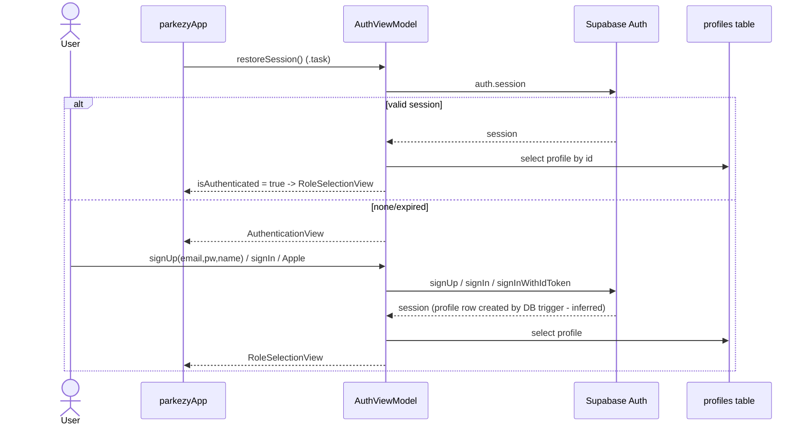
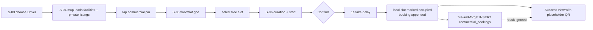
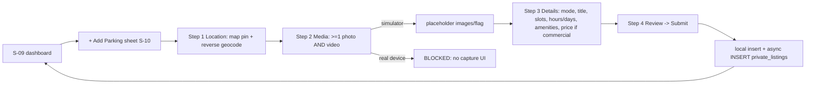
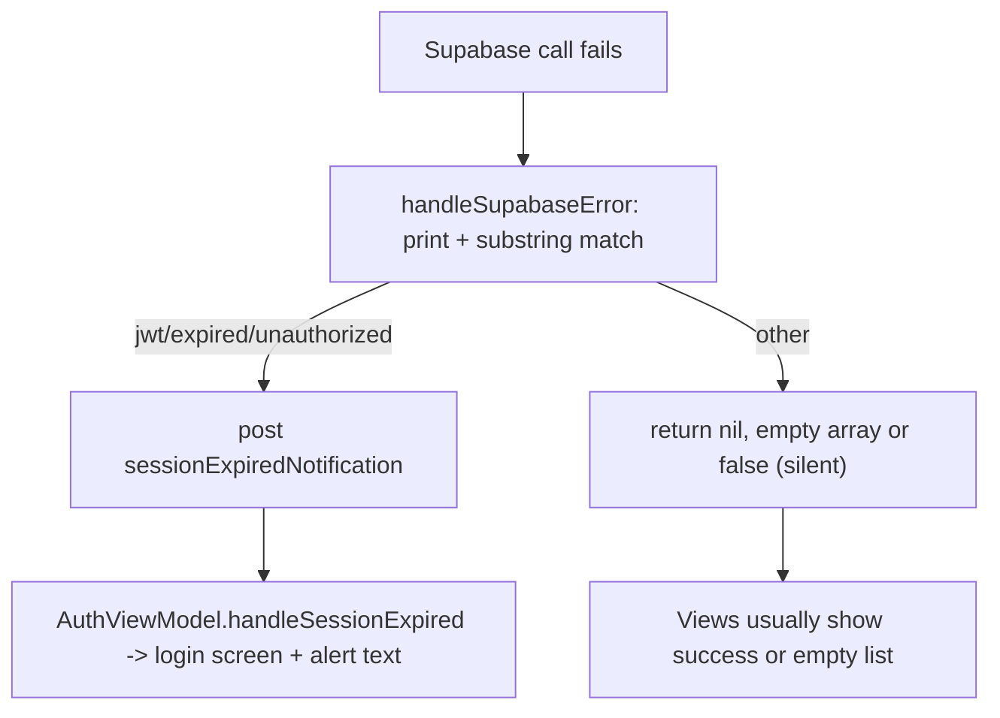

# User Journeys

Journeys are traced from code. "Reachable" means a user can complete it from the app root today.

## J-01 Authentication and onboarding — Reachable

Plain English: on launch the app silently restores a stored Supabase session; otherwise the login/sign-up form appears. A DB trigger (`handle_new_user`, defined in the historical `supabase_schema.sql`, `e72c855`) creates the `profiles` row. Sign-up marks the user authenticated immediately; if the project requires email confirmation there is no session, and later calls will fail (BUG-09). Apple Sign-In is wired in code but the app has no entitlement (F-02). There is no onboarding or capability setup; the user lands on Role Selection.
Errors: inline red text under the form; expiry mid-use posts `sessionExpiredNotification` which logs the user out with a message.

## J-02 Driver books a commercial slot — Reachable (partial)

Steps: the map fetches every `commercial_facilities` and `private_listings` row; tapping a pin opens the facility sheet; a free slot opens the booking sheet; cost = `hourlyRate × duration × 1.18`; confirm creates a `CommercialBooking` (status `.pending`, random 6-digit access code), mutates local state and asynchronously inserts it. No payment, no QR, no confirmation from the server, no booking list, no way to cancel. Another user will not see the slot as occupied unless the facility row's `slots` JSON is updated — **it is never written back** (only the booking row is inserted), so double-booking across devices is possible (BUG-06).

## J-03 Driver requests a private spot — Dead end
Map → tap private pin → S-07 (3 s skeleton) → choose slot → Book → S-08 "Full booking flow coming soon!". The functioning request flow exists only in `PrivateListingDetailView`/`PrivateBookingSheet`, reachable only by hosts viewing their own listing (F-26).

## J-04 Host creates a listing — Reachable on simulator only

Plain English: four-step wizard with per-step validation. Submit builds a `PrivateParkingListing` with randomly-occupied demo slots (`generatePrivateSlots`), stores photos only in memory, inserts the row without checking the result, and dismisses. "Commercial" mode only changes pricing fields and still writes a private listing. Private mode writes `hourlyRate = 0`.

## J-05 Legacy driver session — Unreachable
`SpotDetailSheet → BookingConfirmationView (simulated Apple Pay 2 s) → PINEntryView or QRDisplayView → startSession → ActiveSessionView (1 s timer, running cost, overstay) → Extend / End → ReceiptView → DisputeView`. Persists via `bookings` (`createBookingSession`, `updateBookingSession`) and `parking_spots` occupancy. Never started: `startSession` and `extendSession` are not persisted; occupancy is never set to true, only back to false on end.

## J-06 Host verifies entry/exit by QR — Unreachable
`QRScannerView` (VisionKit or simulator mock) → `HostViewModel.validateQRCode` → `validEntry/validExit/wrongHost/notFound/invalid` → confirm → local state + local notification only. Not persisted; `ownedSpots` empty so every real scan is `wrongHost`.

## J-07 Report a dispute — Unreachable
`ActiveSessionView → DisputeView` (reason picker + description + mock photo) → `createDispute` insert into `disputes`; no resolution UI.

## J-08 Host approves a private request — Absent
Intended: driver request → host notification → approve/reject → PIN issued → slot occupied. Only the view-model methods exist (`approveBooking`, `rejectBooking`); there is no UI, no host-side notification, and drivers never re-fetch their request status.

## Error and recovery flows

Most failures are silent (empty arrays, nil), the UI rarely distinguishes "empty" from "failed" (UX-07).
