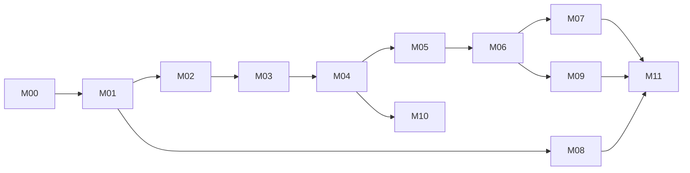

# Implementation Roadmap

Dependency-aware. **Smallest coherent starting milestone: M-00 (closure, no code) followed immediately by M-01.** M-01 comes first because every later feature depends on a reproducible schema with tested RLS, an environment-aware app skeleton, and real auth; the legacy project's central failure is that none of these exist.

| ID | Name | Objective | Prerequisites | Scope (features) | Key tasks | Acceptance | Tests | Risks / open |
|---|---|---|---|---|---|---|---|---|
| M-00 | Discovery closure | Remove unknowns | — | — | Restore Supabase access; export live schema, policies, triggers, row counts and diff against the historical `e72c855:supabase_schema.sql` (drift: 3 tables with no DDL, `bookings.type`, `disputes.photo_urls`); review advisors; answer Q-01–Q-05; confirm [business rules](../product/business-rules.md) with owner; compile legacy app once in Xcode to confirm BUG-01/03 | Schema + RLS exported to a draft migration; decisions logged as ADRs | n/a | R-01, Q-01..Q-05 |
| M-01 | Foundation | Reproducible backend + app skeleton + auth | M-00 | F-01–F-05, F-07, F-10, F-60, F-62 | `supabase/` project (config, migrations, seed); `profiles` + trigger + RLS; test harness (pgTAP); new Xcode project: targets App/Tests/UITests, `.xcconfig` envs, entitlements, Info.plist strings, App Icon, CI; Auth (email, Apple), session scope, role-select shell, offline banner, design system port | Fresh clone → `supabase start` + build + login works; RLS tests T-30, T-04, T-01–T-03 pass; CI green | T-01–T-04, T-30 | Apple capability needs paid account |
| M-02 | Catalog & map | Browse real supply | M-01 | F-20–F-23, F-25, F-47 | `listings`/`slots` tables + PostGIS; seed data; bbox RPC; map with clustering, filters, search; detail screens with loading/empty/error | Map shows seeded supply by viewport; filters server-side | T-10 + UI | Clustering lib (avoid) |
| M-03 | Host listings | Hosts create/manage listings | M-02 | F-41–F-43, F-49 (decision Q-08) | Storage buckets + upload; wizard with real camera/photo picker; edit/delete; ownership RLS; price suggestion RPC | Owner CRUD works; non-owner denied (T-31); real-device photo capture | T-14, T-15, T-31 | Media moderation |
| M-04 | Booking engine | Commercial instant booking + My Bookings | M-02 | F-24, F-28 (pricing), new "My bookings" | `bookings` + exclusion constraint; `create_booking`/`cancel_booking` RPC; server pricing (GST, fees); driver list/detail/cancel | Concurrent booking test passes (T-12); totals match T-11 | T-11, T-12 | Q-03 rules, Q-09 |
| M-05 | Private approvals & notifications | Request → approve flow with push | M-04, APNs | F-26, F-44, F-30 | `approve/reject` RPC, expiry job, push via Edge Function, notification permission in context, host inbox | T-13 passes end-to-end | T-13 | Push cert/keys |
| M-06 | Access & sessions | PIN/QR entry-exit, overstay | M-04 | F-27–F-29, F-46 | `access_grants`, signed QR, `verify_access` RPC with throttle; host scanner (VisionKit) with camera strings; check-in/out, overstay fee; geofence prompts | T-20–T-22 pass | T-20, T-21, T-22 | Camera on simulator |
| M-07 | Payments | Real money flow | M-04 (+M-06 for overstay) | new | Provider SDK (Q-01), payment intent RPC, webhook Edge Function, ledger, receipts (F-33) | Booking confirmed only after provider webhook; refund path | T-60, T-61 | Compliance, provider choice |
| M-08 | Account & settings | Profile, deletion, privacy | M-01 | F-06, F-08, F-09, F-50 | Profile edit; `delete-account` Edge Function; privacy/terms URLs; host onboarding request | T-05 passes; App Store 5.1.1(v) ready | T-05 | Q-07 |
| M-09 | Disputes & admin | Resolve issues | M-06 | F-32 | Evidence upload, dispute states, admin role + minimal web/SQL tooling | Dispute lifecycle test | new | Q-06 |
| M-10 | Host analytics | Real earnings | M-07 | F-40, F-48 | Earnings views from ledger, charts | Sums equal ledger | T-62 | |
| M-11 | Hardening & release | Ship | all above | F-34 (if Q-05) | Accessibility pass, performance, crash reporting, StoreKit/TestFlight, Live Activity/widgets optional | Release checklist ([deployment](../architecture/deployment-and-operations.md)) green | full suite | |

## Definition of done (every milestone)
See [acceptance-criteria](../quality/acceptance-criteria.md). Additionally: milestone's docs updated, ADRs recorded, no unresolved `TODO` without an issue.
