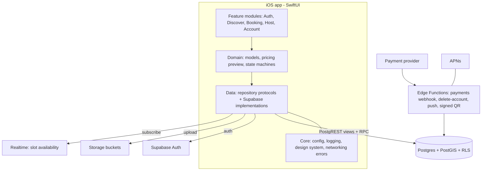

# Target Architecture (proposed)

Constraint (decision made by the owner): **iOS SwiftUI + Supabase**. Everything else below is a recommendation with reasons.

## Overview

## iOS app
- **Modules**: one local Swift package with targets `Core`, `Domain`, `Data`, and feature folders; app target only composes. Rationale: enforces the dependency direction the legacy code lacks without a heavy framework. Optional—a single target with folders is acceptable until M-05.
- **State**: `@Observable` view models per screen/feature, constructed by a composition root and injected through `Environment`; **no app-lifetime singletons that cache user data**; a `SessionScope` object is recreated on login/logout (fixes BUG-07).
- **Data access**: protocol repositories (`ListingRepository`, `BookingRepository`, `AccessRepository`…) returning typed results/`throws`; map errors to a small `AppError` enum; never swallow errors into `[]`.
- **Concurrency**: structured concurrency, cancel tasks on view disappearance, idempotency keys for booking writes.
- **Config**: `Debug/Staging/Release` `.xcconfig` supplying `SUPABASE_URL`, `SUPABASE_ANON_KEY`; Info.plist usage strings and entitlements committed.
- **Extensions**: Widget/Live Activity targets only if Q-05 = yes, fed by server state/push-to-start rather than local timers.
- **Accessibility/UX**: text styles (Dynamic Type), labels, state components from `StandardStateViews` (preserved).

## Backend (Supabase)
| Concern | Design | Why |
|---|---|---|
| Identity | `profiles(id = auth.uid, display_name, phone, avatar_url, created_at)`; `host_profiles(user_id, kind, status, verified_at)` | Capabilities become *data granted by server/admin*, not client JSON |
| Supply | `listings(id, owner_id, kind {private,commercial}, title, geog geography(Point), address, amenities jsonb or columns, pricing…, status)`; `slots(id, listing_id, label, floor, type, price_override, is_active)` | Replaces embedded JSON; allows FK integrity and indexes |
| Bookings | single `bookings(id, listing_id, slot_id, driver_id, tstzrange period, status enum, price breakdown, approval fields)` with **exclusion constraint** `EXCLUDE USING gist (slot_id WITH =, period WITH &&) WHERE status IN (...)` | Eliminates double booking (BUG-06) |
| Access | `access_grants(booking_id, pin_hash, qr_secret, expires_at, attempts)`; RPC `verify_access` | Server-verified PIN/QR (SEC-03/04) |
| Money | `payments`, `ledger_entries`, `payouts` (if Q-01 ≠ none) | Auditability |
| Sessions | `parking_sessions(booking_id, checked_in_at, checked_out_at, overstay_minutes, fee)` | Replaces client timers/overstay math |
| Disputes | `disputes`, `dispute_evidence` (Storage paths), admin role | Close the loop |
| Ops | RPCs: `create_booking`, `approve_booking`, `cancel_booking`, `check_in/out`; Edge Functions: `delete-account`, `payment-webhook`, `send-push` | Rules in one place, testable |
| Security | RLS on all tables; `SECURITY DEFINER` functions with fixed `search_path`; column privileges revoked for privileged fields | |
| Observability | Supabase logs + advisors in CI, structured client logger (`os.Logger`), crash reporting (decision) | |
| Geo | PostGIS + GiST index; RPC `listings_in_bbox(min_lat,…)` | Replaces "fetch everything" |

## Migration/data implications
Legacy rows cannot be trusted (slots JSON, display-string enums, random data). Treat live data as seed/test data unless Q-12 says otherwise; write a one-off SQL migration if needed after schema export (M-00).

## Technology deliberately *not* introduced
TCA/Redux, Combine pipelines, third-party DI, GraphQL, custom backend service, SwiftData offline cache (revisit after M-04 if offline browsing is a goal).
